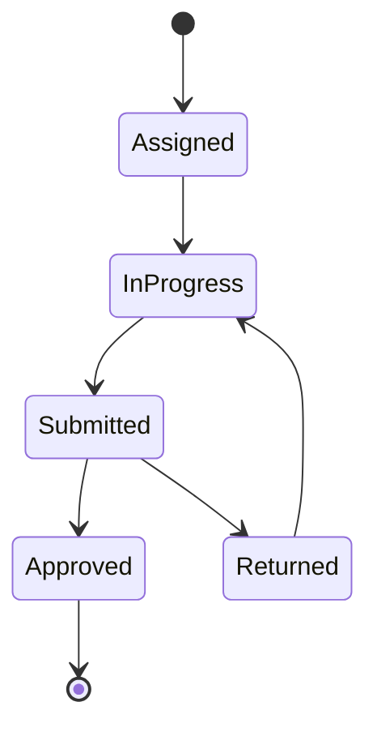

# Baseerah PRD

Sep 24, 2026 · @gorgi fido

> **Master plan.** This file is the source of truth for what Baseerah builds.
> Plans in `docs/plans/` and issues in `.scratch/` trace back to the FR/NFR IDs
> below. Change scope here first, then in the code.

## Overview

Deal Oracle grows from a deal-screening tool into a workspace for the whole VC team: partners delegate diligence, associates draft it, portfolio companies report into it, and LPs see performance from it.

**Goals**

- Cut the time from inbound deal to diligence memo by letting associates draft from proprietary data plus web search.
- Give partners one place to assign work, track it, and see market signals.
- Replace email chasing for portfolio updates with scheduled requests and automated monitoring.
- Sell team plans with per-seat billing, so the firm, not the individual, is the customer.

**Non-goals (this release)**

- Fund accounting, capital calls, or K-1 generation. LP views read performance data; they do not compute it.
- A general-purpose CRM. Contact data serves deal and market research only.

## Users and roles

Five roles, three of them inside the firm. "Senior staff" means partners and principals; "junior staff" means associates.

| Role | Who | Core jobs |
| --- | --- | --- |
| Partner | Firm decision-maker, billing owner | Assign diligence, view market trends, request portfolio updates, buy plans and manage seats |
| Principal | Senior investor | Set firm settings (thesis, check size, rounds), edit diligence templates, request portfolio updates |
| Associate | Junior investor | View and complete assigned tasks, draft diligence |
| LP | External investor in the fund | View investment performance (read-only) |
| Portfolio company | Founder or finance lead at an investee | Answer update requests (no seat, link-based access) |

All firm roles can manage meeting points and paste meeting notes.

## Functional requirements

Fourteen requirements in five areas. IDs keep the numbers from the source list so the two can be traced.

### Diligence and tasks

| ID | Requirement | Role | Acceptance criteria |
| --- | --- | --- | --- |
| FR-01 | Assign diligence and contact tasks to associates | Partner | Task links to a deal and names an assignee, due date and diligence subprocess (e.g. market, team, financials, references); assignee is notified |
| FR-13 | View assigned tasks | Associate | Associate sees only their own tasks, filterable by deal, status and due date; overdue tasks are flagged |
| FR-14 | Complete tasks | Associate | Associate attaches output and marks the task submitted; the assigning partner can approve it or return it with a comment |
| FR-06 | Draft diligence from proprietary data and web search | Associate | Draft follows the firm's template (FR-12), cites every web claim with a link, and marks which facts came from firm data |
| FR-12 | Edit diligence templates | Principal | Principal adds, removes and reorders template sections; existing drafts keep the template version they started from |

A task moves from assignment to approval; a returned task goes back to the associate.

### Portfolio

| ID | Requirement | Role | Acceptance criteria |
| --- | --- | --- | --- |
| FR-02 | Request updates from portfolio companies | Partner, Principal | Request names the metrics wanted (e.g. revenue, burn, runway, headcount) and a deadline; company answers through a link without an account; reminders go out before the deadline |
| FR-04 | Automate portfolio monitoring | Partner, Principal | Recurring update requests on a schedule (monthly or quarterly); alerts when a metric crosses a set threshold or a company misses a deadline |
| FR-07 | View investment performance | LP | LP sees per-fund figures (e.g. TVPI, DPI, IRR) and a holdings list; read-only; LPs never see deal pipeline or diligence |

### Market intelligence

| ID | Requirement | Role | Acceptance criteria |
| --- | --- | --- | --- |
| FR-05 | Get latest startup data and trends | All firm roles | Data shows its source and last-updated date; users can filter by sector, stage and geography |
| FR-08 | View market trends: founders raising, team deep dive, contact information | Partner | List of companies currently raising, a team profile per company, and contact details with their source; matches ranked against the firm thesis (FR-03) |

### Firm settings and billing

| ID | Requirement | Role | Acceptance criteria |
| --- | --- | --- | --- |
| FR-03 | Set thesis, check size and preferred rounds | Principal | Settings apply firm-wide and feed deal screening and market matching; changes are logged with author and date |
| FR-09 | Buy plan tiers and manage seats | Partner | Partner upgrades, downgrades and buys extra seats; invites, reassigns or removes associates and principals; a seat frees when a member is removed |

### Meetings

| ID | Requirement | Role | Acceptance criteria |
| --- | --- | --- | --- |
| FR-10 | Create, read, update and delete meeting points | All firm roles | Meeting points link to a deal or portfolio company; edits keep author and time |
| FR-11 | Paste in-person meeting notes | All firm roles | Pasted notes attach to a deal; key points and follow-ups are extracted into meeting points the user can edit |

## Non-functional requirements

Only NFR-01 came from the source list. The rest are proposed defaults for a multi-role product that holds confidential deal and LP data; confirm or cut them.

| ID | Area | Requirement | Source |
| --- | --- | --- | --- |
| NFR-01 | Performance | Chatbot returns a full response in under 60 s; first tokens stream within 5 s | Source list (5 s streaming target proposed) |
| NFR-02 | Access control | Every role sees only what the Users and roles table grants; enforced in the database (row-level security), not only in the UI | Proposed |
| NFR-03 | Data isolation | No firm can read another firm's deals, diligence, notes or settings | Proposed |
| NFR-04 | Security | Tokens and secrets encrypted at rest; LP and portfolio-company links expire and can be revoked | Proposed |
| NFR-05 | Long-running work | Diligence drafts and portfolio scans that outlast a hosting function timeout run in batches or background jobs and show progress | Proposed |
| NFR-06 | Traceability | AI-drafted diligence cites a source for every external claim | Proposed |
| NFR-07 | Auditability | Changes to settings, templates, seats and task status are logged with author and time | Proposed |
| NFR-08 | Availability | 99.5% monthly uptime for the web app | Proposed |
| NFR-09 | Usability | Core flows work on a laptop and a phone-width screen | Proposed |

## Open questions

- [ ] Source list has no item 15, and item 16 is blank. Were requirements dropped?
- [ ] Non-functional item 2 stops at "Allow". What was it meant to say?
- [ ] Where does LP performance data come from: manual entry, CSV upload, or a fund-admin integration?
- [ ] Which provider supplies startup, founder and contact data (FR-05, FR-08), and what are its licensing limits on contact details?
- [ ] Can principals also assign tasks, or only partners (FR-01)?
- [ ] Do LPs and portfolio companies count against paid seats (FR-09)?
- [ ] Should drafting diligence (FR-06) count against the plan's screening quota, or be metered separately?
